<div align="center">

<!-- PORTRAIT: halftone dots that fly in and assemble outward from the face, then a
     light sweep passes over them every 7 s. Generated by scripts/portrait.py; separate
     dark and light renders because a halftone reads differently on each background. -->
<picture>
  <source media="(prefers-color-scheme: dark)"  srcset="assets/portrait-dark.svg">
  <source media="(prefers-color-scheme: light)" srcset="assets/portrait-light.svg">
  
</picture>

<br>

<!-- TERMINAL: self-hosted typing animation (scripts/build.py, from profile.json) -->
<picture>
  <source media="(prefers-color-scheme: dark)"  srcset="assets/terminal-dark.svg">
  <source media="(prefers-color-scheme: light)" srcset="assets/terminal-light.svg">
  
</picture>

<br><br>

<a href="https://www.linkedin.com/in/vedanth-raj"></a>
<a href="mailto:pvvraj1234433@gmail.com"></a>
<a href="https://github.com/vedanth-raj?tab=repositories"></a>


</div>

---

## `~/` whoami

```console
$ cat about.txt
```

Hi, I'm **P V V Raj**, though most people call me **Vedanth**. I'm a Data Science undergrad at
NMIMS Hyderabad who likes building things end to end: serverless backends on AWS, full-stack web
apps, and computer-vision pipelines that have to keep up with a live camera.

- **Now:** AWS Student Builder Campus Leader & Group Leader, running hands-on cloud build sessions on campus
- **Recently:** Full-stack intern at **Infosys**, working on an AI research-paper review app ([LitWise AI](https://github.com/vedanth-raj/R-A))
- **Off-screen:** Head of the **Robotics Club (Vinyasa)** at NMIMS, and winner of **Drone Conquest, Kaunyak 2026**
- **Looking for:** SDE internships and new-grad roles

<br>

<div align="center">

## `~/` toolbox


</div>

---

<div align="center">

## `~/` experience

<picture>
  <source media="(prefers-color-scheme: dark)"  srcset="assets/timeline-dark.svg">
  <source media="(prefers-color-scheme: light)" srcset="assets/timeline-light.svg">
  
</picture>

</div>

---

<div align="center">

## `~/` selected work

<table>
<tr>
<td width="50%">
  <a href="https://github.com/vedanth-raj/R-A">
    <picture>
      <source media="(prefers-color-scheme: dark)"  srcset="assets/card-R-A-dark.svg">
      <source media="(prefers-color-scheme: light)" srcset="assets/card-R-A-light.svg">
      
    </picture>
  </a>
</td>
<td width="50%">
  <a href="https://github.com/vedanth-raj/Hospital-management-system">
    <picture>
      <source media="(prefers-color-scheme: dark)"  srcset="assets/card-Hospital-management-system-dark.svg">
      <source media="(prefers-color-scheme: light)" srcset="assets/card-Hospital-management-system-light.svg">
      
    </picture>
  </a>
</td>
</tr>
<tr>
<td width="50%">
  <a href="https://github.com/vedanth-raj/ats">
    <picture>
      <source media="(prefers-color-scheme: dark)"  srcset="assets/card-ats-dark.svg">
      <source media="(prefers-color-scheme: light)" srcset="assets/card-ats-light.svg">
      
    </picture>
  </a>
</td>
<td width="50%">
  <picture>
    <source media="(prefers-color-scheme: dark)"  srcset="assets/card-ai-recipe-generator-dark.svg">
    <source media="(prefers-color-scheme: light)" srcset="assets/card-ai-recipe-generator-light.svg">
    
  </picture>
</td>
</tr>
</table>

<sub>

| project | what it shows | stack |
|---|---|---|
| **[LitWise AI](https://github.com/vedanth-raj/R-A)** | NLP pipeline: ingest, segment, summarise, peer-review | `Python` `Flask` `Gemini` |
| **[Smart Hospital Management](https://github.com/vedanth-raj/Hospital-management-system)** | role-based full-stack app, 8+ modules | `Next.js` `Node.js` `MongoDB` |
| **[Face Auth Attendance](https://github.com/vedanth-raj/ats)** | real-time CV, 98.5% accuracy at 50 ms | `OpenCV` `Dlib` `ResNet-50` |
| **AI Recipe Generator** | serverless on 7 AWS services, 5 Lambdas | `Lambda` `DynamoDB` `Bedrock` |
| **AquaFlow** | freelance build for Indian Railways: pool membership & billing | `JavaScript` `Tailwind` `Vite` |

</sub>

</div>

---

<div align="center">

## `~/` skill radar

<table>
<tr>
<td width="52%" align="center" valign="middle">

<picture>
  <source media="(prefers-color-scheme: dark)"  srcset="assets/radar-dark.svg">
  <source media="(prefers-color-scheme: light)" srcset="assets/radar-light.svg">
  
</picture>

</td>
<td width="48%" valign="middle">

**certifications**

- AWS Academy Cloud Foundations
- AWS Academy Graduate: Machine Learning Foundations
- Cisco Networking Basics & Operating Systems

**leadership**

- AWS Student Builder Campus Leader & Group Leader
- Head, Robotics Club (Vinyasa), NMIMS
- Winner, Drone Conquest, Kaunyak 2026

**cs fundamentals**

`DSA` `OOP` `DBMS` `Operating Systems` `Complexity Analysis`

</td>
</tr>
</table>

</div>

---

<div align="center">

## `~/` the numbers

<!-- Live: regenerated daily by .github/workflows/build.yml -->
<picture>
  <source media="(prefers-color-scheme: dark)"  srcset="assets/stats-dark.svg">
  <source media="(prefers-color-scheme: light)" srcset="assets/stats-light.svg">
  
</picture>

<br><br>

<picture>
  <source media="(prefers-color-scheme: dark)"  srcset="assets/calendar-dark.svg">
  <source media="(prefers-color-scheme: light)" srcset="assets/calendar-light.svg">
  
</picture>

<br><br>

<!-- The snake lives on the `output` branch, written by .github/workflows/snake.yml -->
<picture>
  <source media="(prefers-color-scheme: dark)"  srcset="https://raw.githubusercontent.com/vedanth-raj/vedanth-raj/output/snake-dark.svg">
  <source media="(prefers-color-scheme: light)" srcset="https://raw.githubusercontent.com/vedanth-raj/vedanth-raj/output/snake-light.svg">
  
</picture>

</div>

---

<div align="center">

<sub>

```console
$ exit   # thanks for scrolling. let's build something.
```

</sub>

</div>
